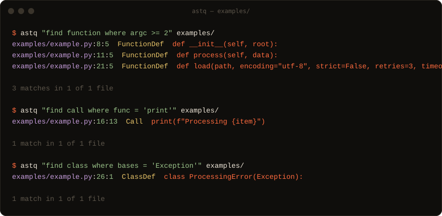

<div align="center">

# AST-Query

**grep for the shape of Python code.**

Search Python source by structure, not by text, with a query language small enough to remember.

[](https://github.com/chandana-galgali/AST-Query/actions/workflows/tests.yml)
[](https://www.python.org/downloads/)
[](pyproject.toml)
[](LICENSE)

### [▶ Try it in your browser](https://chandana-galgali.github.io/AST-Query/)



</div>

---

## Why

Text search can't tell a function *definition* from a function *call*, a string from a comment, or a long function from a short one. Python's `ast` module can, but exploring a syntax tree by hand means writing a visitor class for every question.

AST-Query sits in between. It lets you ask structural questions in one line:

```bash
astq "find function where lines > 40 and not docstring" src/   # long, undocumented functions
astq "find call where func = 'eval'" .                         # every eval() call
astq "find class where bases ~= 'Exception$'" .                # custom exception classes
astq "find import where names.name = 'pickle'" .               # who imports pickle?
astq "find function where argc >= 6" .                         # functions with too many parameters
```

## Install

```bash
pip install git+https://github.com/chandana-galgali/AST-Query
```

That gives you the `astq` command (also available as `ast-query`, or `python -m ast_query`). It has no dependencies outside the standard library.

To work on the code itself:

```bash
git clone https://github.com/chandana-galgali/AST-Query.git
cd AST-Query
pip install -e .
```

## Usage

```text
astq QUERY [PATH ...]
```

`PATH` can be files or directories (default: the current directory). Directories are searched recursively. Hidden folders such as `.git` and `.venv`, plus `__pycache__`, `node_modules`, `build` and `dist`, are skipped.

| Option | What it does |
| --- | --- |
| `-i`, `--ignore-case` | Compare values case-insensitively |
| `-c`, `--count` | Print only the number of matches |
| `-l`, `--files-with-matches` | Print only the names of files that matched |
| `-s`, `--show-code` | Print the full source of every match |
| `--json` | Machine-readable output (path, type, line, col, end, code) |
| `--dump FILE` | Print the AST of a file to discover node types and attribute names |
| `--list-types` | List every node type, alias and virtual attribute |
| `--color auto\|always\|never` | Control colored output (also respects `NO_COLOR`) |

Exit status works like `grep`: `0` if anything matched, `1` if nothing did, `2` on an error.

## The query language

```text
find <type>[, <type> ...] [where <condition> [and <condition> ...]]
```

### Node types

Use a friendly alias or any class from Python's [`ast`](https://docs.python.org/3/library/ast.html) module, written as `FunctionDef` or `function_def`. Abstract classes such as `stmt` and `expr` work too.

| Alias | Matches |
| --- | --- |
| `function`, `def` | `FunctionDef`, `AsyncFunctionDef` |
| `class` | `ClassDef` |
| `call` | `Call` |
| `import` | `Import`, `ImportFrom` |
| `loop` | `For`, `AsyncFor`, `While` |
| `for_loop` / `while_loop` | `For`, `AsyncFor` / `While` |
| `if`, `try`, `with`, `assign`, `return`, `yield`, `await`, `raise`, `assert`, `lambda` | the matching statements and expressions |
| `comprehension` | list, set and dict comprehensions, and generator expressions |
| `any` | every node |

Typos get a suggestion: `find functon` → *Did you mean 'function'?*

### Conditions

| Operator | Meaning | Example |
| --- | --- | --- |
| `=` (or `==`) | equals | `name = 'main'` |
| `!=` | does not equal | `name != '__init__'` |
| `~=` | regex search | `name ~= '^test_'` |
| `!~` | regex does not match | `name !~ '^_'` |
| `<` `<=` `>` `>=` | numeric comparison | `lines > 50` |
| *(none)* | attribute is non-empty / truthy | `where docstring` |
| `not …` | negates a condition | `where not docstring` |

Values can be `'single'` or `"double"` quoted, numbers, or bare words (`name = main`). Comparisons are case-sensitive unless you pass `-i`.

There are three rules that make the language more powerful than it looks:

1. **Dotted paths follow nested attributes.** For example, `func.attr = 'join'` and `args.args.arg = 'self'`.
2. **Lists match if any element matches.** `decorator_list = 'property'` finds properties, and `names.name = 'os'` checks every name in an import.
3. **Attributes holding AST nodes compare by their source code.** That's why `func = 'os.path.join'`, `bases = 'Exception'` and `decorator_list = 'app.route'` just work.

### Virtual attributes

These are computed for you on top of the real `ast` attributes:

| Attribute | Value |
| --- | --- |
| `lines` | number of lines the node spans |
| `argc` | parameter count (functions, lambdas) or argument count (calls) |
| `docstring` | the docstring of a module, class or function (`""` if none) |
| `name` | dotted name for calls, names and attributes, e.g. `os.path.join` |
| `source` | the node's code, via `ast.unparse` |
| `line`, `end_line`, `col`, `type` | position and class name |

Not sure what an attribute is called? Run `astq --dump file.py`, or open the **ast** tab in the [playground](https://chandana-galgali.github.io/AST-Query/).

### Cookbook

```bash
# Functions and classes
astq "find function where name ~= '^test_'" tests/
astq "find function where decorator_list = 'property'" .
astq "find function where decorator_list ~= 'app\.(get|post)'" .
astq "find class where not docstring" .

# Calls
astq "find call where name = 'subprocess.run'" .
astq "find call where func.attr = 'execute'" .
astq "find call where func = 'open' and argc = 1" .   # open() without an explicit mode

# Code smells
astq "find function where lines > 60" .
astq "find function where argc > 5" .
astq "find try where handlers.type = 'Exception'" .   # broad except clauses
astq "find compare where ops = 'Is' and comparators.value = 0"

# Literals
astq "find constant where value = 'TODO'" .
astq "find constant where value > 1000" .
```

## Use it as a library

```python
from ast_query import find

source = open("app.py").read()
for m in find("find call where func = 'print'", source, path="app.py"):
    print(f"{m.path}:{m.line}:{m.col + 1}  {m.code}")
```

`find()` returns `Match` objects with `node`, `type`, `line`, `col`, `end_line`, `end_col`, `code` and `path`. You can also call `parse_query()` once and reuse the `Query`, or `matches(node, query)` to test a single node.

## How it works

```text
"find call where func = 'print'"
        │
        ▼
  query.py      tokenizer + recursive-descent parser → Query(types, conditions)
        │
        ▼
  matcher.py    ast.walk() every node → isinstance check → resolve dotted paths
                (flattening lists, adding virtual attributes) → compare
        │
        ▼
  cli.py        file discovery, colored grep-style output, JSON, exit codes
```

The [playground](https://chandana-galgali.github.io/AST-Query/) runs these same files unmodified in your browser through [Pyodide](https://pyodide.org) (CPython compiled to WebAssembly), so the code you paste never leaves the page.

## Project layout

```text
ast_query/
  query.py      the query language: tokenizer, parser, type aliases
  matcher.py    evaluating queries against an AST, Match results
  parser.py     reading source files and walking directories
  cli.py        the astq command
docs/
  index.html    the browser playground (deployed to GitHub Pages)
  demo.svg      the terminal screenshot above
examples/
  example.py    a small file to try queries on
tests/          unit tests for the language, matcher and CLI
```

## Development

```bash
pip install -e . pytest
pytest                       # runs the unit tests and doctests
```

To preview the playground locally, serve the **repository root** so the page can load the package files:

```bash
python -m http.server 8000
# then open http://localhost:8000/docs/
```

GitHub Actions run the tests on Python 3.9 to 3.13 for every push. On each push to `main`, the playground is redeployed to GitHub Pages. In the repo settings, under **Settings → Pages → Source**, choose **GitHub Actions** once.

## Possible extensions

The project is feature-complete for its purpose. These ideas would build naturally on it:

- `within` scoping, e.g. `find call where func = 'print' within function where name = 'main'`
- `or` between conditions, plus parentheses
- An editor integration (a VS Code extension or LSP) that runs queries in the workspace

## License

[MIT](LICENSE) © 2025 Chandana Galgali
